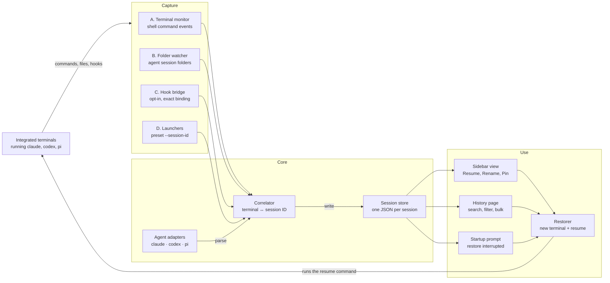

# Agent Session Keeper — VS Code Extension Spec

Oct 12, 2026 · Danny

## Overview

Agent Session Keeper is a personal VS Code extension that notices when you start Claude Code, Codex or pi in an integrated terminal, records that agent's session ID with a title and timestamps, and gives you a history page where one click reopens the session in a new terminal.

The key fact behind the design: all three agents already save their full conversation to disk and can resume it by ID. What a restart destroys is only the link between "this terminal" and "that session ID". The extension keeps that link and replays the agent's own resume command (`claude --resume <id>`, `codex resume <id>`, `pi --session <id>`).

**Goals**

- Zero-effort capture: typing `claude`, `codex` or `pi` in any terminal creates a record, with no wrapper or alias required.
- Each record holds agent, session ID, title, working directory, workspace, date started, date last active, status, terminal name, launch command, transcript path and git branch.
- A sidebar view and a full history page, each with Resume, Rename, Pin and Archive.
- After a crash or restart, a prompt offers to restore every session that was still running.
- Crash-safe: records are written as events happen, never only on shutdown.

**Non-goals for v1**

- Storing or copying transcripts; the agents own those files.
- Syncing history across machines.
- Driving the agent (sending prompts, reading its output).

## Research findings

All three agents write one JSONL file per session to a predictable folder and accept a session ID on the command line to resume, so the extension never has to scrape terminal output. Two of them (Claude Code and pi) also let you choose the ID before launch, which makes capture exact.

| | Claude Code | Codex CLI | pi |
| --- | --- | --- | --- |
| Session file | `~/.claude/projects/<project>/<session-id>.jsonl`; `<project>` is the cwd with non-alphanumerics replaced by `-` | `~/.codex/sessions/YYYY/MM/DD/rollout-<timestamp>-<uuid>.jsonl` | `~/.pi/agent/sessions/--<path>--/<timestamp>_<session-id>.jsonl` |
| Root override | `CLAUDE_CONFIG_DIR` | `CODEX_HOME` | `PI_CODING_AGENT_DIR`, `PI_CODING_AGENT_SESSION_DIR`, `--session-dir` |
| Set ID at launch | `--session-id <uuid>` | Not supported | `--session-id <id>` |
| Set name at launch | `-n, --name <name>` | No CLI flag found | `-n, --name <name>` |
| Resume by ID | `claude --resume <id>` (any directory) | `codex resume <id or name>` | `pi --session <id, partial id or path>` |
| Metadata in file | Format is internal and changes between versions; ID = file name | First line `session_meta`: id, timestamp, cwd, CLI version, git branch | First line `type: session`: id, timestamp, cwd, version; `session_info` entries carry the display name |
| Lifecycle hooks | `SessionStart` (startup, resume, clear, compact, fork), `UserPromptSubmit`, `Stop`, `SessionEnd`; input has `session_id`, `transcript_path`, `cwd` | Same event names and fields; hooks must be trusted once via `/hooks` | TypeScript extensions in `~/.pi/agent/extensions/` |
| Retention | Deleted after 30 days by default (`cleanupPeriodDays`) | Kept; `codex archive` / `codex delete` | Kept until deleted |

Three findings shape the design:

1. **One terminal can hold several sessions over its life.** Claude's `/clear`, `/resume` and `/branch`, Codex's `/resume` and pi's `/new` and `/fork` all switch to a different session ID without restarting the process. Capture must watch for changes, not record once at launch.
2. **Only the outer envelope of each file is safe to parse.** Anthropic's docs state the Claude transcript format is internal and changes between releases. The extension relies on file names, first lines and modification times, and treats anything deeper (first prompt, message counts) as optional.
3. **Claude transcripts expire.** A record older than 30 days may point at a deleted file, so the history page must show it as missing rather than fail on resume.

## Architecture

Four capture signals feed one correlator, which writes plain JSON records; every surface reads those records and resumes a session by opening a terminal that runs the agent's own resume command.



The correlator alone decides which terminal holds which session. Adapters keep agent-specific parsing out of it, and the store is the single source of truth shared by every VS Code window.

## Session capture

Capture combines four signals, from always-on to opt-in; each later one makes binding more exact, and any one alone still produces a usable record.

### A. Command detection (always on)

Subscribe to `window.onDidStartTerminalShellExecution`. The event carries the terminal, `execution.commandLine.value` and `execution.cwd`. Tokenize the command line and match the first token (after stripping `env VAR=x`, `npx`, `bunx`, `pnpm dlx`) against each adapter's patterns.

- Ignore non-interactive runs and subcommands: `claude -p`, `claude mcp …`, `codex exec …`, `codex login`, `pi -p`, `pi install …`.
- If the command already names a session (`--session-id X`, `--resume X` / `-r X`, `codex resume X`, `pi --session X`), bind immediately.
- Otherwise create a `PendingLaunch { terminalKey, agent, cwd, commandLine, startedAt, shellPid }` and wait for signal B or C.
- `onDidEndTerminalShellExecution` for that execution marks the bound session `exited`; `onDidCloseTerminal` marks it `closed`.

Shell integration works automatically in bash, zsh, fish and pwsh (Git Bash and pwsh on Windows). It does not work inside tmux, plain `ssh` or some custom prompts; signals B and C cover those cases.

### B. Session-folder watcher (always on)

Watch each adapter's session root with `fs.watch` (recursive) or `chokidar`, debounced 250 ms. On a new or changed `.jsonl`:

1. Read the first 64 KB and let the adapter return `{ sessionId, cwd, startedAt, name? }`. For Claude, the ID is the file name and the cwd check is `encodeProjectDir(pending.cwd) === parentDirName`.
2. Match the oldest unbound `PendingLaunch` with the same agent and cwd, started no more than 2 s before the file was created.
3. A changed (not new) file with no pending launch is an existing session becoming active: update `lastActiveAt`, and if a pending launch used `-c`, `--continue`, `resume --last` or `-r` with no ID, bind to it.
4. A new file appearing in a cwd where a terminal already has a bound, still-running session is a mid-session switch (`/clear`, `/new`, `/fork`). Rebind that terminal and set `parentSessionId` on the new record.

Two launches of the same agent in the same folder within the window are ambiguous; bind in start order and flag the records `bindingConfidence: "low"` until signal C confirms.

### C. Hook bridge (opt-in, exact)

A command `Agent Sessions: Install Agent Hooks` writes `SessionStart`, `UserPromptSubmit` and `Stop` hooks into `~/.claude/settings.json` and `~/.codex/hooks.json`, and drops a small pi extension into `~/.pi/agent/extensions/`. It merges into existing JSON, keeps a `.bak` copy, and is idempotent; an uninstall command removes only its own entries.

Each hook runs `node ~/.agent-sessions/bin/hook.js <agent>`, which reads the hook JSON on stdin and appends one line to `~/.agent-sessions/spool/events-YYYY-MM-DD.jsonl`:

```json
{"agent":"claude","event":"SessionStart","source":"clear","session_id":"…","transcript_path":"…","cwd":"…","ts":"2026-10-12T21:30:00Z","terminalId":"…","ancestorPids":[48211,48190,48102]}
```

Terminal matching uses two keys: `AGENT_SESSIONS_TERMINAL_ID` (set only on terminals the extension creates) and the hook's ancestor PIDs, compared with `await terminal.processId` (the shell's PID). The script must exit 0 within 200 ms and print nothing, so it never blocks or alters the agent. Codex will ask you to trust the new hooks once in `/hooks`.

### D. Launcher commands (exact)

`New Claude Session`, `New Codex Session` and `New pi Session` ask for an optional title, generate a UUID, create a terminal named `<agent>: <title>` with `AGENT_SESSIONS_TERMINAL_ID` in its env, and run `claude --session-id <uuid> --name "<title>"` or `pi --session-id <uuid> --name "<title>"`. Codex cannot take a preset ID, so its launcher relies on B or C.

### Titles and activity

- **Title**, first available wins: title you set in the extension → agent's own name (Claude `--name`/`/rename`, pi `session_info.name`) → first user prompt, 80 characters → `<agent> · <folder> · <start time>`.
- **Last active**: the later of the transcript's modification time and the latest `UserPromptSubmit` or `Stop` hook event. Modification time works for every agent without parsing.

## Data model and storage

Records live as one JSON file per session under `~/.agent-sessions/`, not in VS Code's `globalStorageUri`, so every VS Code window, the hook script and any other tool share one plain-text history.

```text
~/.agent-sessions/               (setting: agentSessions.storageDir)
  sessions/
    claude/<sessionId>.json
    codex/<sessionId>.json
    pi/<sessionId>.json
  spool/events-YYYY-MM-DD.jsonl  hook events, append-only, pruned after 14 days
  bin/hook.js                    hook bridge, copied from the extension on activate
```

Why one file per session: each VS Code window runs its own extension host, so two windows can update records at the same moment. Separate files mean a write only ever touches one session. Every write goes to `<file>.tmp` then `rename`, so a crash never leaves half a file. When two windows write the same record, merge field by field and keep the newer `updatedAt`. Each window watches `sessions/` and refreshes its views on change.

```ts
type AgentId = 'claude' | 'codex' | 'pi';
type SessionStatus =
  | 'pending'      // launch seen, ID not bound yet
  | 'running'      // bound to a live terminal
  | 'exited'       // agent process ended, terminal still open
  | 'closed'       // terminal closed normally
  | 'interrupted'  // was running when VS Code went away (set on next activation)
  | 'missing'      // transcript file no longer exists
  | 'archived';    // hidden by the user

interface SessionRecord {
  schemaVersion: 1;
  agent: AgentId;
  sessionId: string;
  title: string;
  titleSource: 'user' | 'agent' | 'firstPrompt' | 'fallback';
  cwd: string;
  workspaceFolder?: string;     // fsPath of the workspace folder containing cwd
  workspaceName?: string;
  gitBranch?: string;
  createdAt: string;            // ISO 8601, first seen
  lastActiveAt: string;         // transcript mtime or latest hook event
  lastResumedAt?: string;
  status: SessionStatus;
  bindingConfidence: 'exact' | 'high' | 'low';
  launch: {
    commandLine: string;
    via: 'shell-integration' | 'launcher' | 'hook' | 'import';
    terminalName?: string;
    shellPid?: number;
    windowSessionId?: string;   // vscode.env.sessionId of the owning window
  };
  transcriptPath?: string;
  parentSessionId?: string;     // set after /clear, /new, /fork, /branch
  pinned?: boolean;
  notes?: string;
  machine: string;              // os.hostname()
  updatedAt: string;
}
```

Example record:

```json
{
  "schemaVersion": 1,
  "agent": "claude",
  "sessionId": "550e8400-e29b-41d4-a716-446655440000",
  "title": "Refactor auth middleware",
  "titleSource": "agent",
  "cwd": "/Users/me/code/api",
  "workspaceFolder": "/Users/me/code/api",
  "workspaceName": "api",
  "gitBranch": "feat/auth",
  "createdAt": "2026-10-12T14:02:11.000Z",
  "lastActiveAt": "2026-10-12T16:47:30.000Z",
  "status": "interrupted",
  "bindingConfidence": "exact",
  "launch": { "commandLine": "claude -n \"Refactor auth middleware\"", "via": "shell-integration", "terminalName": "zsh", "shellPid": 48102 },
  "transcriptPath": "/Users/me/.claude/projects/-Users-me-code-api/550e8400-e29b-41d4-a716-446655440000.jsonl",
  "machine": "my-mac",
  "updatedAt": "2026-10-12T16:47:31.000Z"
}
```

The extension keeps a runtime-only map `terminal → current sessionKey` in memory. It is never persisted, because terminal objects do not survive a restart; on activation it is rebuilt from `window.terminals` by matching `shellPid` and terminal name.

## Restore flow and UI

On every activation the extension finds sessions that were running when VS Code went away, marks them `interrupted`, and offers to reopen them; the same Resume action is available any time from the sidebar and the history page.

### Detecting interrupted sessions

The extension host can be killed without `deactivate` running, so nothing is decided at shutdown. On activation (`onStartupFinished`):

1. Load all records. For each `running` or `pending` record whose `launch.windowSessionId` differs from the current `vscode.env.sessionId`, look for a live terminal in `window.terminals` with the same `shellPid` (a window reload can reconnect live terminals).
2. Found: rebind it, keep `running`. Not found: set `interrupted`.
3. If any `interrupted` records belong to the current workspace, apply `agentSessions.restoreOnStartup`.

### Resuming one session

1. If a live terminal is already bound to the session, focus it and stop.
2. Check the transcript still exists (Claude's 30-day cleanup); if not, mark `missing` and say so.
3. Check `cwd` exists; if not, ask for a folder.
4. `window.createTerminal({ name: "<icon> <title>", cwd, env: { AGENT_SESSIONS_TERMINAL_ID }, iconPath: new ThemeIcon(agentIcon) })`.
5. Wait up to 3 s for `onDidChangeTerminalShellIntegration`; then run the command with `terminal.shellIntegration.executeCommand(cmd)`, or fall back to `terminal.sendText(cmd)`.
6. Bind the terminal, set `running` and `lastResumedAt`.

The resume command comes from a per-agent template so you can add your usual flags:

| Agent | Default template |
| --- | --- |
| Claude Code | `claude --resume ${sessionId}` |
| Codex | `codex resume ${sessionId}` |
| pi | `pi --session ${sessionId}` |

"Restore all" runs the same steps for each selected session, 500 ms apart, so shells do not start at once.

### Surfaces

The screens are mocked up in `docs/design/` — open the HTML files in a browser.

- **Sidebar view** (activity bar container "Agent Sessions"): groups Interrupted, Running, This workspace and All workspaces. Each item shows the title, with agent and relative time as its description, and details in the tooltip. Inline actions: Resume, Rename, Pin. Context menu: Copy resume command, Open transcript, Show terminal, Archive, Delete record.
- **History page** (`WebviewPanel`): a searchable, sortable table with filters for agent, workspace, status and date range. Columns: title, agent, folder, branch, started, last active, status. Row actions match the sidebar, plus multi-select "Resume selected". The page talks to the extension via `postMessage`, and a `WebviewPanelSerializer` restores it after a reload.
- **Status bar item**: `$(history) 3 interrupted`, shown only when there is something to restore; click to open the restore picker.
- **Startup notification**: "3 agent sessions were interrupted when VS Code closed." with Restore all, Choose… and Dismiss.

## Manifest

The extension contributes 11 commands, one sidebar view, one webview and 8 settings; it activates on `onStartupFinished` so capture is running before you open your first terminal.

Key `package.json` fields:

- `engines.vscode`: the first release where `window.onDidStartTerminalShellExecution` is stable (1.93; confirm against `vscode.d.ts` before pinning).
- `extensionKind: ["workspace"]`: run where the terminals and agent files are, including Remote-SSH, WSL and Dev Containers.
- `activationEvents`: `onStartupFinished`, `onView:agentSessions.tree`, `onWebviewPanel:agentSessions.history`.

**Commands** (prefix `agentSessions.`)

| Command ID | Title |
| --- | --- |
| `openHistory` | Agent Sessions: Open History |
| `resume` | Resume Session |
| `restoreInterrupted` | Restore Interrupted Sessions… |
| `newClaude` | New Claude Code Session |
| `newCodex` | New Codex Session |
| `newPi` | New pi Session |
| `rename` | Rename Session |
| `togglePin` | Pin / Unpin Session |
| `archive` | Archive Session |
| `installHooks` | Install Agent Hooks (exact capture) |
| `uninstallHooks` | Remove Agent Hooks |

Also register internal commands for the context menu: `copyResumeCommand`, `openTranscript`, `showTerminal`, `deleteRecord`, `importExisting`.

**Views**: a `viewsContainers.activitybar` entry `agentSessions` (icon `$(history)`) holding the tree view `agentSessions.tree`, with `view/title` buttons for Open History, New Session and Refresh.

**Settings**

| Setting | Type | Default | Purpose |
| --- | --- | --- | --- |
| `agentSessions.storageDir` | string | `~/.agent-sessions` | Where records, spool and hook script live |
| `agentSessions.restoreOnStartup` | `prompt` \| `always` \| `never` | `prompt` | What to do with interrupted sessions on startup |
| `agentSessions.agents.<id>.enabled` | boolean | `true` | Turn capture on or off per agent |
| `agentSessions.agents.<id>.commandPatterns` | string[] | `["claude"]`, `["codex"]`, `["pi"]` | Extra names and aliases to detect, e.g. `cc` |
| `agentSessions.agents.<id>.resumeCommand` | string | see restore table | Resume template; `${sessionId}`, `${cwd}`, `${title}` |
| `agentSessions.agents.<id>.sessionRoot` | string | agent default | Override when you set `CLAUDE_CONFIG_DIR`, `CODEX_HOME` or `PI_CODING_AGENT_DIR` |
| `agentSessions.titleFromFirstPrompt` | boolean | `true` | Off if prompts may contain secrets |
| `agentSessions.terminalLocation` | `panel` \| `editor` | `panel` | Where resumed terminals open |

## Project layout and module specs

Write it in TypeScript, bundle with esbuild, and keep every agent-specific detail behind one `AgentAdapter` interface so a fourth agent is one new file.

```text
agent-session-keeper/
  package.json  tsconfig.json  esbuild.mjs  .vscodeignore  README.md
  src/
    extension.ts               activate(): build services, register views and commands
    model/types.ts             AgentId, SessionRecord, PendingLaunch, SessionFileInfo
    store/SessionStore.ts      load, upsert, merge, delete; emits onDidChange
    store/atomicWrite.ts       write tmp + rename
    agents/AgentAdapter.ts     interface + registry
    agents/commandLine.ts      tokenizer, wrapper stripping (env, npx, bunx)
    agents/claude.ts
    agents/codex.ts
    agents/pi.ts
    capture/TerminalMonitor.ts     shell-integration events → PendingLaunch
    capture/SessionDirWatcher.ts   watches agent session roots
    capture/HookSpoolReader.ts     tails spool/*.jsonl
    capture/Correlator.ts          binds launches, files and hook events to records
    capture/processTree.ts         ancestor PIDs (Linux /proc, macOS ps, Windows CIM)
    restore/Restorer.ts            resume one or many
    restore/StartupRestore.ts      interrupted detection + prompt
    hooks/installer.ts             merge/unmerge hook config, copy hook.js
    ui/SessionTreeProvider.ts
    ui/HistoryPanel.ts             webview host + message protocol
    ui/StatusBar.ts
  media/history.html  history.js  history.css
  resources/hook.js  resources/pi-extension.ts
  test/unit/  test/integration/  test/fixtures/{claude,codex,pi}/
```

### AgentAdapter

```ts
interface CommandMatch {
  interactive: boolean;          // false for -p, exec, login, mcp, install…
  explicitSessionId?: string;    // from --session-id, --resume X, resume X, --session X
  isResume: boolean;             // includes -c / --continue / resume --last
  name?: string;                 // from -n / --name
}

interface SessionFileInfo {
  sessionId: string;
  cwd?: string;
  startedAt?: string;
  name?: string;                 // agent's own display name, if any
  firstPrompt?: string;          // optional, best effort
  gitBranch?: string;
}

interface AgentAdapter {
  id: AgentId;
  displayName: string;
  icon: string;                                   // codicon id
  supportsPresetId: boolean;                      // claude, pi: true
  defaultPatterns: string[];
  matchCommand(argv: string[]): CommandMatch | undefined;
  sessionRoots(): string[];                       // honours env overrides + setting
  isSessionFile(path: string): boolean;
  readSessionFile(path: string): Promise<SessionFileInfo | undefined>;
  fileBelongsToCwd(path: string, info: SessionFileInfo, cwd: string): boolean;
  transcriptPathFor(rec: SessionRecord): Promise<string | undefined>;
  buildNewCommand(o: { sessionId?: string; name?: string }): string;
  buildResumeCommand(rec: SessionRecord, template: string): string;
}
```

Per-adapter notes:

- **claude.ts**: ID = file base name. `fileBelongsToCwd` compares the parent folder with `cwd.replace(/[^A-Za-z0-9]/g, '-')`; for names over 200 characters, compare the first 200 only, since Claude truncates and appends a hash. Read the name and first prompt defensively from the first 64 KB and ignore failures.
- **codex.ts**: parse the first line (`session_meta`) for id, cwd, timestamp and git branch. Glob both `rollout-*.jsonl` and `rollout-*.jsonl.zst`; for compressed files use the UUID in the file name and skip body parsing.
- **pi.ts**: parse the first line (`type: "session"`) for id and cwd; scan for the last `session_info` entry for the name.

### Correlator rules

- Inputs: `PendingLaunch` events, `SessionFileInfo` events, `HookEvent` lines, terminal close and end events.
- Precedence for binding a terminal: hook event with matching terminal ID or PID → explicit ID on the command line → file watcher match by agent + cwd + time window.
- A hook `SessionStart` with `source` of `clear`, `resume` or `fork` on an already-bound terminal moves the terminal to the new session and sets `parentSessionId` when the source is `clear` or `fork`.
- Pending launches with nothing bound after 10 minutes are dropped; the terminal stays watched.
- Every bind writes the record immediately; activity updates are throttled to one write per session per 10 s.

## Build plan for a coding agent

Build in seven milestones; milestones 1 to 5 alone solve the restart problem, and 6 and 7 make capture exact and the tool pleasant. Finish each milestone's acceptance checks before starting the next.

**Instructions for the agent**: read this whole document first. Use TypeScript strict mode, no runtime dependencies beyond `chokidar` (optional) and `@vscode/test-electron` for tests. Never write to agent config files outside the hook installer, and never parse transcript content beyond what the adapter notes allow. Commit after each milestone.

1. **Scaffold** — `yo code` TypeScript template converted to esbuild; activation on `onStartupFinished`; a `LogOutputChannel` named "Agent Sessions".
    - Done when: F5 opens an Extension Development Host and the log shows "activated".
2. **Model and store** — `types.ts`, `atomicWrite.ts`, `SessionStore` with per-file records, field-level merge and a watcher on `sessions/`.
    - Done when: unit tests pass for create, update, merge-by-`updatedAt`, and two concurrent writer processes updating different fields of one record without losing either.
3. **Adapters** — `commandLine.ts` plus the three adapters with fixture-based tests.
    - Done when: table-driven tests cover at least 25 command lines (aliases, `npx`, `env X=1`, `-p`, subcommands, `--resume X`, `resume --last`) and each adapter reads its fixtures to the expected `SessionFileInfo`.
4. **Capture** — `TerminalMonitor`, `SessionDirWatcher`, `Correlator`.
    - Done when: running `claude`, `codex` and `pi` in a terminal each creates a record within 5 s of the first prompt; `/clear` creates a second record linked by `parentSessionId`; closing the terminal sets `closed`.
5. **Restore** — `Restorer`, `StartupRestore`, status bar item.
    - Done when: with two agents running, quitting and reopening VS Code shows the notification; Restore all opens two terminals in the right folders running the right resume commands; a session whose transcript was deleted shows as `missing`.
6. **UI** — tree view, history webview, rename, pin, archive, copy command, open transcript.
    - Done when: search and filters work on 500 synthetic records in under 100 ms; a rename survives a reload and is visible in a second window.
7. **Exact capture** — launcher commands, `hooks/installer.ts`, `resources/hook.js`, `resources/pi-extension.ts`, `HookSpoolReader`, `processTree.ts`; also `importExisting` to backfill records from existing session folders.
    - Done when: two `claude` sessions started in the same folder within 1 s bind to the correct terminals; install then uninstall leaves `~/.claude/settings.json` and `~/.codex/hooks.json` byte-identical to the originals.

Package with `vsce package` and install the `.vsix` locally; publishing to the Marketplace is not needed for personal use.

## Testing plan

Most behaviour is testable without real agents: fake `claude`, `codex` and `pi` scripts on `PATH` write realistic session files into a temporary home, so integration tests are fast, free and deterministic.

- **Unit tests** (Mocha or Vitest): command-line matching, each adapter's file reader against fixtures, store merge rules, Correlator scenarios driven by a fake clock and synthetic events (out-of-order file and launch events, two launches in one folder, `/clear` mid-session, a hook arriving before the file).
- **Fixtures**: one real, scrubbed session file per agent and per version you use, in `test/fixtures/<agent>/<version>/`. When an agent updates, add a new fixture; a failing reader test is the early warning that a format changed.
- **Integration tests** (`@vscode/test-electron`): point `CLAUDE_CONFIG_DIR`, `CODEX_HOME` and `PI_CODING_AGENT_DIR` at a temp folder, prepend a `test/bin` folder of fake agents to `PATH`, open terminals, run the fakes, and assert on the records written. The fakes print a prompt, create the session file on the first line of stdin, append on each later line, and honour `--session-id` and `--resume`.
- **Restart test**: write `running` records with a foreign `windowSessionId`, activate the extension, and assert they become `interrupted` and that Restore all sends the expected command to each new terminal.
- **Manual checklist** before calling v1 done: bash, zsh and pwsh; a terminal in the editor area; a Remote-SSH window; tmux inside a VS Code terminal (expect watcher-only capture); quitting VS Code with three agents running.

The step-by-step manual test guide for the owner is in `docs/TESTING.md`.

## Edge cases and risks

The biggest risk is agents changing their file formats, so the design depends only on file names, first lines and modification times; every other risk below has a fallback path.

| Risk | Effect | Mitigation |
| --- | --- | --- |
| Agent changes its session file format | Titles or binding stop working | Read only the envelope; fixtures per version catch it in tests; a reader failure still yields a record titled by fallback |
| No shell integration (tmux, plain `ssh`, unsupported shell) | Signal A is silent | Watcher binds by cwd to the terminal whose shell cwd matches, or to the workspace folder; hooks give exact binding |
| Aliases and wrappers (`cc`, `npx @anthropic-ai/claude-code`) | Launch not detected | `commandPatterns` setting; strip `npx`, `bunx`, `pnpm dlx`, `env` |
| Several VS Code windows | Two hosts write the same record | One file per session, atomic rename, field-level merge, `windowSessionId` marks which window owns a running session |
| Remote windows (SSH, WSL, containers) | Agent files live on the remote machine | `extensionKind: ["workspace"]` so the extension runs beside them |
| Claude 30-day cleanup | Resume fails with "No conversation found" | Check the file first, mark `missing`; README suggests raising `cleanupPeriodDays` |
| Codex compressed rollouts | Header unreadable | Take the UUID from the file name; skip body parsing |
| Session switches inside one terminal | Record points at the old session | Watcher and `SessionStart` hooks rebind and link `parentSessionId` |
| Launch flags not restored on resume (Claude does not restore `--mcp-config`, `--add-dir`, `--settings`) | Resumed session misses tools | Keep the original command line; offer `${launchArgs}` in the resume template |
| Prompts in titles may hold secrets | Sensitive text in a local file | Records stay local; `titleFromFirstPrompt` can be turned off |
| Hook installer edits your agent configs | A bad merge breaks agent startup | Opt-in, `.bak` copy, JSON validation before write, exact uninstall; hook script always exits 0 within 200 ms |

## References

- [Claude Code CLI reference](https://code.claude.com/docs/en/cli-reference): `--session-id`, `--resume`, `--name`, `--fork-session`
- [Claude Code: Manage sessions](https://code.claude.com/docs/en/sessions): transcript location, naming, retention
- [Claude Code hooks reference](https://code.claude.com/docs/en/hooks): `SessionStart` sources and input fields
- [Codex developer commands](https://learn.chatgpt.com/docs/developer-commands?surface=cli): `codex resume`, archive, delete
- [Codex hooks](https://learn.chatgpt.com/docs/hooks.md): events, config locations, trust review
- [Codex session file layout (txcript docs)](https://docs.rs/crate/txcript/latest/source/docs/formats/codex.md): `rollout-*.jsonl` naming and `session_meta`
- [pi sessions](https://app.unpkg.com/@earendil-works/pi-coding-agent@0.83.0/files/docs/sessions.md): `--session`, `--name`, `-c`, `-r`
- [pi session file format](https://app.unpkg.com/@earendil-works/pi-coding-agent@1.1.0/files/docs/session-format.md): file location, header, `session_info`
- [VS Code API reference](https://code.visualstudio.com/api/references/vscode-api): terminal shell execution events, `createTerminal`, tree views, webviews
- [VS Code terminal shell integration](https://code.visualstudio.com/docs/terminal/shell-integration): supported shells and limits
